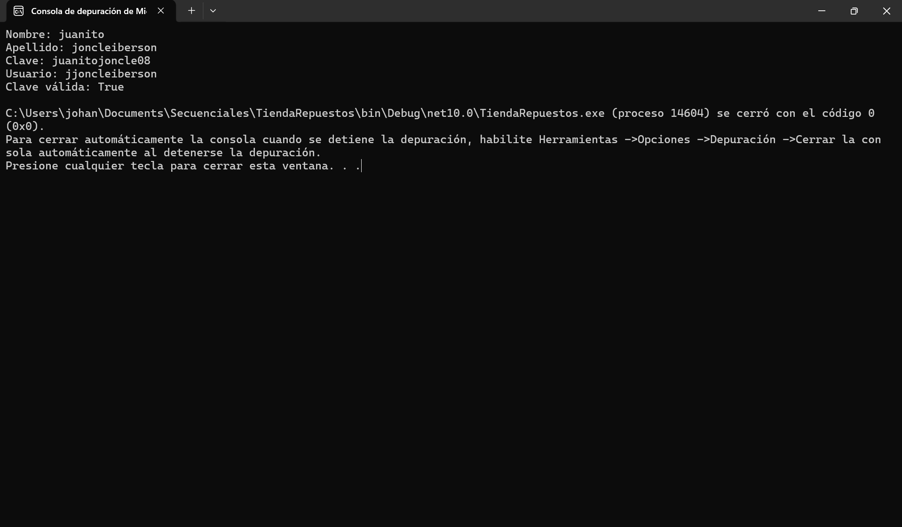
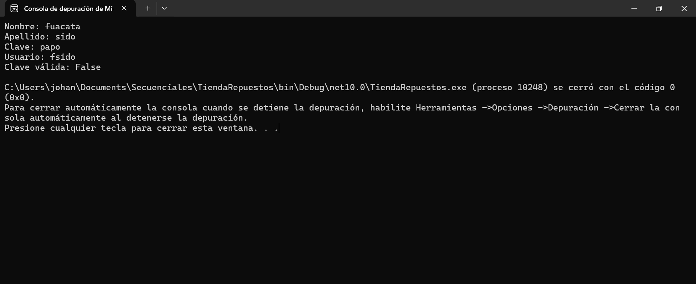
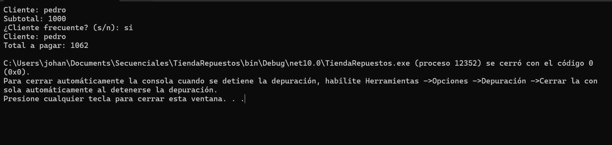
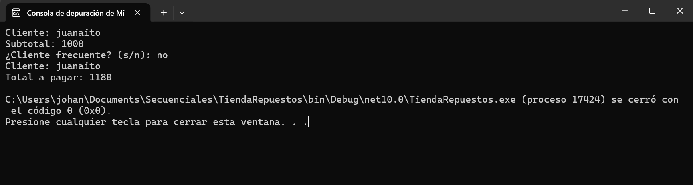

# Ejercicios de Funciones y Procedimientos en C#

## 1. Datos de los integrantes

- **Yoiser Cedano Arredondo**
- **Marcos Bastista Robles**

## 2. Descripción

Este proyecto contiene dos ejercicios desarrollados en C# sobre el tema de funciones y procedimientos.

---

# Ejercicio 1: Generación de usuario y validación de clave

## 3. Entrada

El programa solicita al usuario los siguientes datos:

- Nombre.
- Apellido.
- Clave.

## 4. Proceso

- **LeerTexto():** solicita y lee los datos introducidos por el usuario.
- **GenerarUsuario():** crea un nombre de usuario utilizando la primera letra del nombre y el apellido en minúsculas.
- **ValidarClave():** comprueba que la clave tenga al menos 8 caracteres y que no contenga espacios.

## 5. Salida

- El nombre de usuario generado.
- Si la clave es válida o no.
- Un mensaje de error si el nombre o el apellido están vacíos.

## 6. Capturas de pantalla

**Escenario 1: Datos correctos**

### Escenario 1: Datos correctos

### Escenario 2: Datos incorrectos

**Escenario 2: Datos incorrectos**

---

# Ejercicio 2: Tienda de repuestos

## 3. Entrada

El programa pide al usuario los siguientes datos:

- Nombre del cliente.
- Subtotal de la venta.
- Si el cliente es frecuente (sí o no).

## 4. Proceso

El programa utiliza dos métodos:

- **CalcularTotal():** aplica un descuento del 10 % al subtotal si el cliente es frecuente, luego calcula el ITBIS del 18 % y devuelve el total a pagar.
- **MostrarFactura():** muestra el nombre del cliente y el total de la factura.

En el método principal Main() se solicitan los datos del cliente y se utilizan los métodos para realizar los cálculos y mostrar la factura.

## 5. Salida

El programa muestra:

- El nombre del cliente.
- El total a pagar después de aplicar el descuento, si corresponde, y agregar el ITBIS del 18 %.

## 6. Capturas de pantalla

**Escenario 1: Cliente frecuente**

**Escenario 2: Cliente no frecuente**

---

# 7. Tecnologías utilizadas

- Lenguaje  C#.
- Visual Studio.
- Métodos, funciones y procedimientos.
- La consola de VS

---

